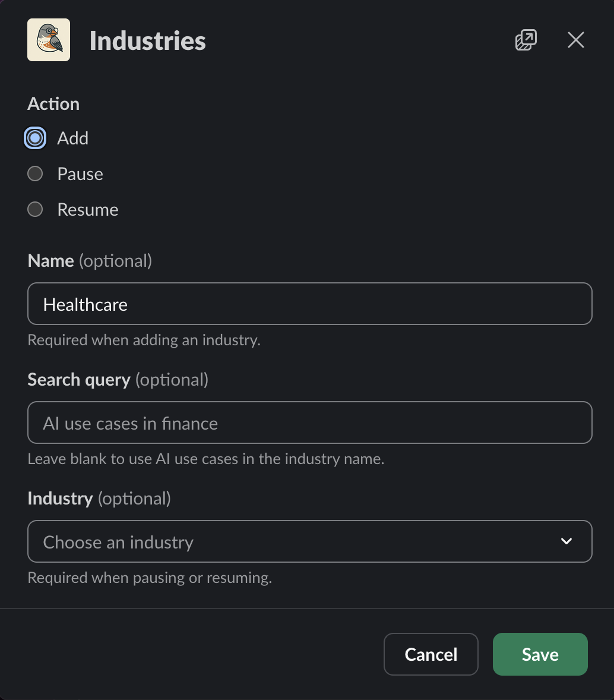
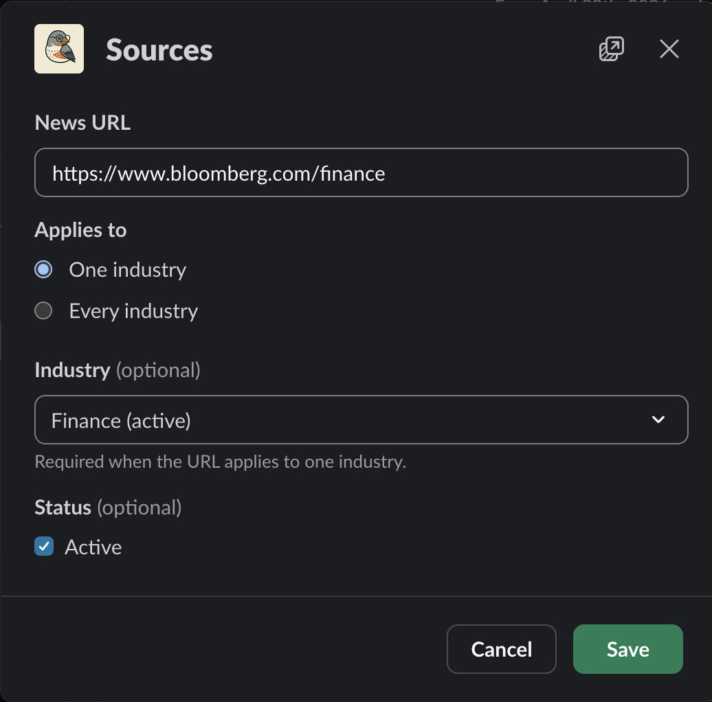
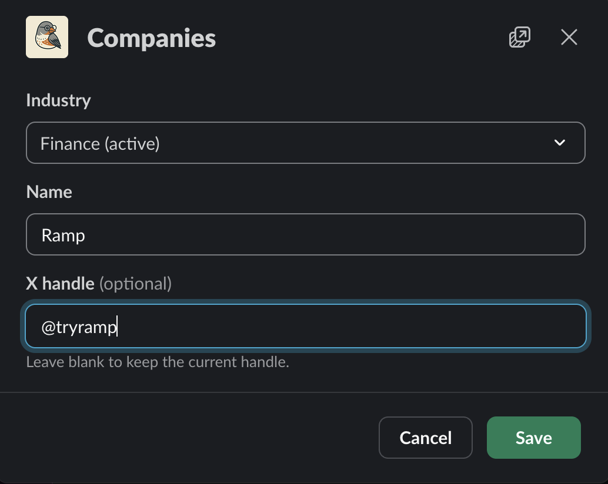
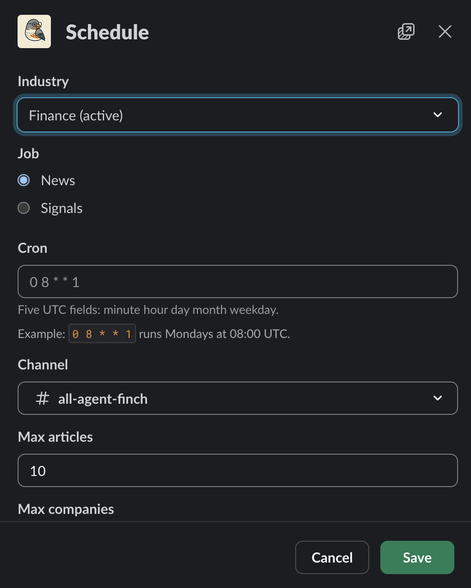
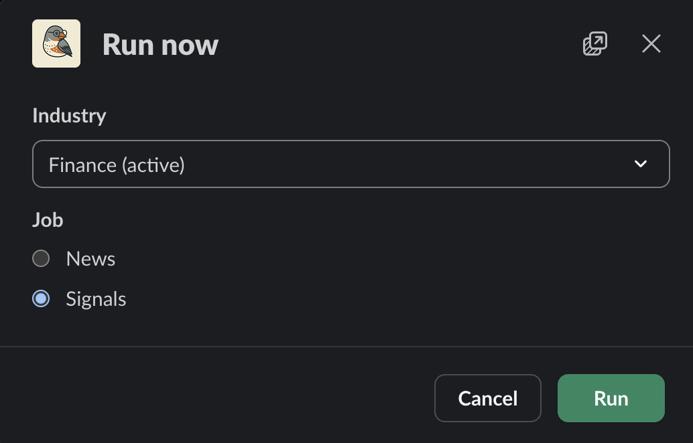
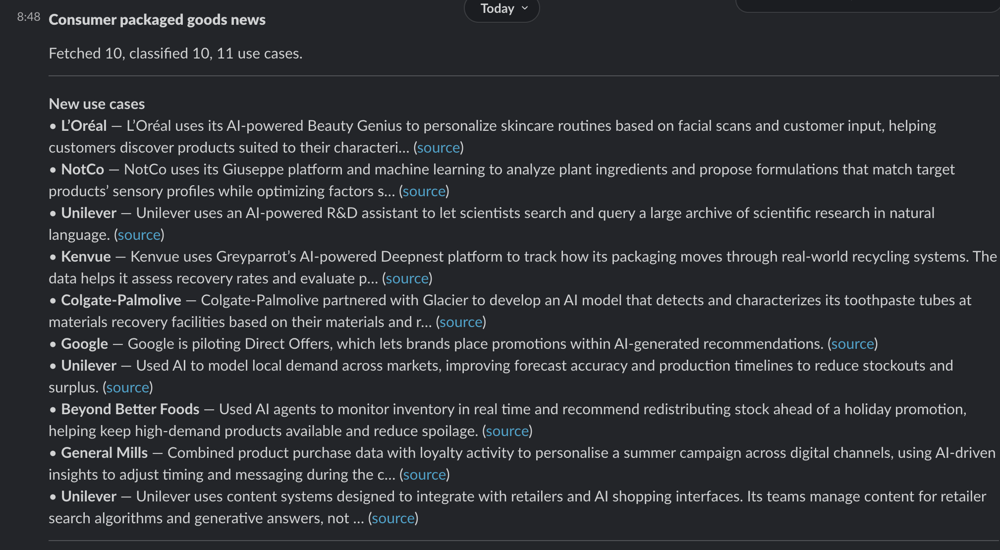
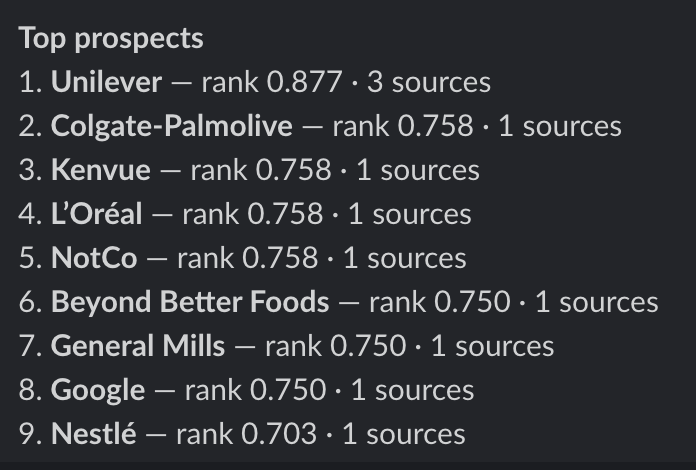
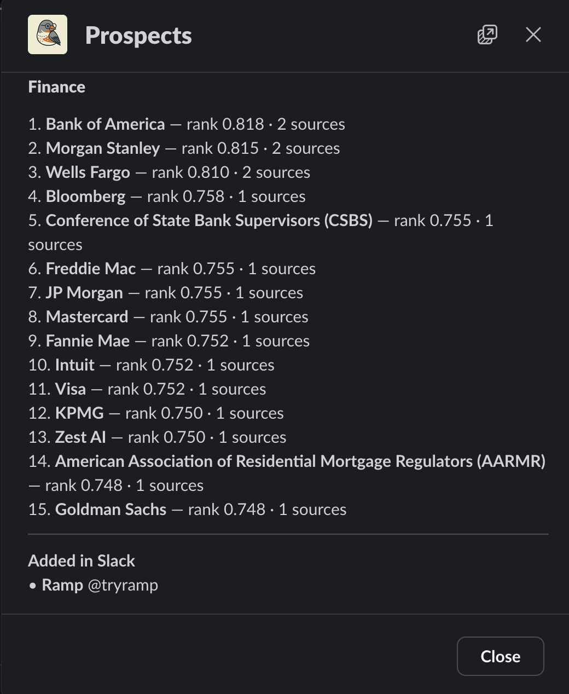

# AI business prospector

A Slack app that finds companies adopting AI and posts the stronger buying signals. One process runs FastAPI, Slack Bolt, and the scheduler. Configuration and digests stay in Slack. There is no web UI.

## Business case

The app is a first pass for selling into companies that are adopting AI. For each industry, it reads public coverage and recent posts on X, then posts a short Slack digest: named use cases, a ranked list of companies, and the posts that look like a buying motion.

A news job searches industry coverage and the URLs you save. It drops pages that are not about AI news or an AI workflow, extracts a use case when a company is doing something concrete, and ranks prospects by recency, how many distinct sources named them, and extraction confidence. A signals job then searches the last seven days of X for those companies. A post is shown only when it reads as evaluating, piloting, implementing, or selecting a vendor. A passing mention is stored and left out of the channel.

Finance and consumer packaged goods are seeded so the first crawl has industries to run. Add more industries, news URLs, and companies from Slack. A company you already want to watch is included even when the news crawl has not mentioned it yet.

The design notes, including the data model and build phases, are in [docs/architecture_plan.md](docs/architecture_plan.md).

## Architecture

```mermaid
flowchart LR
  slack[Slack commands] --> api[FastAPI plus Bolt]
  api --> db[(Postgres)]
  scheduler[APScheduler] --> db
  scheduler --> newsJob[News job]
  scheduler --> signalJob[Signal job]
  newsJob --> firecrawl[Firecrawl]
  newsJob --> decisions[Decisions API]
  newsJob --> graph[LangGraph]
  signalJob --> xapi[X recent search]
  signalJob --> decisions
  signalJob --> db
  graph --> db
  newsJob --> digest[Slack digest]
  signalJob --> digest
```

Slack commands and the scheduler both write through the same FastAPI process. News fetches pages with Firecrawl, classifies them with the Decisions API, and sends the keepers to LangGraph for extraction. Signals search recent posts on X, score them with the Decisions API, and write the scores to Postgres. Both jobs post a digest back to Slack.

## Decisions API

Classification and scoring go through the [Decisions API](https://developers.openai.com/api/docs/guides/decisions) (`POST /v1/decisions`, model `gpt-6-luna`, public beta). A call sends shared input plus typed questions and returns probabilities, a choice, or a score. It does not write a paragraph or a JSON object. OpenAI documents those answers as about 10 times faster than the same judgment through the Responses API. Billing on `gpt-6-luna` is input tokens only, **$0.10 per 1M tokens**, with no output, cache-read, or cache-write charge. A refusal is treated as below the cutoff.

LangGraph still extracts use cases, because that step has to return company names, summaries, and evidence quotes. The Decisions API runs first so that generative call only sees pages worth extracting.

### News: one call per article

Each new article is one `decisions.create`. The input is the title plus the first 20,000 characters of markdown. Questions on that call are independent and share the input, so the article is sent once:

| Question | Type | Passes when |
|---|---|---|
| `ai_news` — is this about AI news? | predicate | probability ≥ 0.5 |
| `ai_workflow` — is this about AI in a business workflow? | predicate | probability ≥ 0.5 |
| `industry_{slug}` — is this about that industry? | predicate, one per active industry | probability ≥ 0.5 |

The article is AI-related when either AI predicate clears 0.5. Industries that also clear 0.5 are linked. An AI-related article that matches no industry applies to every industry. Anything under 0.5 on both AI questions is stored so it is not fetched again, and it is not extracted. The 0.5 cutoff is a constant in code.

That is the cost cut. A page that fails the gate never pays for a LangGraph extraction. Asking every industry in the same call means a second industry does not require a second read of the article.

### Signals: one call per post

Each new X post is one `decisions.create`. The input is the company name and the post text. A single `score` question, `strength`, rates the buying signal on ordered levels:

| Index | Label | Meaning |
|---|---|---|
| 0 | none | Not evidence the company is buying or adopting AI |
| 1 | weak | A passing mention, not a buying motion |
| 2 | moderate | Evaluating, piloting, or implementing |
| 3 | strong | An active buy, such as an RFP, a vendor selection, or a rollout |

The stored strength is the probability-weighted average of those indices, so it can fall between levels. Slack gets the post only when that score is at least 2. The digest shows the level label of the highest-probability level. There is no generated reason to wait on or pay for.

## How to use it

Slack is the interface. One workspace, two jobs per industry.

1. Start Postgres and the app. See [Run locally](#run-locally) and [Slack setup](#slack-setup).
2. In a channel the bot has joined, `/prospect industries`, `/prospect sources`, and `/prospect companies` add the vertical, the news URLs, and any companies to watch.
3. `/prospect schedule` saves a cron, a channel, and caps for `news` or `signals`. `/prospect run` runs one job now. The digest is posted in the channel where you ran the command. A scheduled run posts to the channel saved on the schedule.
4. `/prospect prospects` shows the current ranked list, including companies added in Slack that do not have a rank yet.

Run news before signals. Signals only look at companies already on the list. Caps on the schedule limit articles fetched, companies queried, and posts read on one run.

A news run opens with an ephemeral note to the person who started it (`Running news for Consumer packaged goods.`), then posts a digest in the channel. A full example is under [Digests](#digests).

## Run locally

Requires Python 3.11+, [uv](https://docs.astral.sh/uv/), and Docker.

```bash
cp .env.example .env
make up
make sync
make migrate
make serve
```

The API listens on `http://127.0.0.1:8000`. `GET /health` returns the number of cron jobs currently registered.

Fill in the API keys in `.env` before a job can call Firecrawl, X, or OpenAI. Slack setup is below. `make test` runs the suite against `TEST_DATABASE_URL`, which must be a different database from `DATABASE_URL`.

Run a single replica. A second process would register the same cron and fire each job twice.

## Slack setup

Create an app at [api.slack.com/apps](https://api.slack.com/apps) for one workspace. Local development uses Socket Mode. Production uses the Events API over HTTP. Both modes use the same bot token and signing secret.

### Tokens

From **Basic Information → App Credentials**, copy the **Signing Secret** into `SLACK_SIGNING_SECRET`.

From **OAuth & Permissions**, add these bot token scopes, then install the app to the workspace:

| Scope | Why |
|---|---|
| `commands` | Slash command `/prospect` |
| `chat:write` | Digests and the "running" note |
| `channels:read` | Channel picker for public channels |
| `groups:read` | Channel picker for private channels |

Copy the **Bot User OAuth Token** (`xoxb-`) into `SLACK_BOT_TOKEN`. Reinstall the app after any scope change.

Invite the bot into the channel that should receive digests (`/invite @Your Bot`). The bot can only post where it is a member.

### Socket Mode

Use this on a laptop. Slack connects out to the process, so you do not need a public URL.

1. Open **Settings → Socket Mode** and turn it on.
2. Generate an app-level token with the `connections:write` scope.
3. Put that token (`xapp-`) in `SLACK_APP_TOKEN`.
4. Open **Interactivity & Shortcuts** and turn interactivity on. Leave the request URL empty.
5. Open **Slash Commands** and create `/prospect`. Leave the request URL empty. The description can be `Configure prospecting and run jobs`.
6. Restart with `make serve`. The log line `Slack Socket Mode connected` means the process is receiving commands.

### HTTP

Use this when the process has a public HTTPS URL. Leave `SLACK_APP_TOKEN` empty. The process then serves Bolt at `POST /slack/events`.

1. Turn **Socket Mode** off.
2. Open **Interactivity & Shortcuts**, turn interactivity on, and set the request URL to `https://<your-host>/slack/events`.
3. Create the `/prospect` slash command with the same request URL.
4. Under **Event Subscriptions**, turn events on and set the request URL to the same path. Bolt answers Slack's URL verification from that route.

Slack must reach that URL before it will save the setting. `GET /health` is separate and does not verify Slack requests.

### Commands

`/prospect` with no arguments lists these. Each one opens a dialog.

#### `/prospect industries`

Add, pause, or resume an industry.



#### `/prospect sources`

Save a news URL for one industry, or for every industry.



#### `/prospect companies`

Save a company name and an optional X handle.



#### `/prospect schedule`

Set the job, cron, channel, and caps.



#### `/prospect run`

Run news or signals now. The digest is posted in the channel where you ran the command.



A news digest lists new use cases, then the current top prospects.





#### `/prospect prospects`

Show the ranked companies, and companies added in Slack that do not have a rank yet.



Cron expressions are five fields in UTC: minute, hour, day of month, month, day of week. `0 8 * * 1` runs Mondays at 08:00 UTC. An invalid expression is rejected and the previous schedule is left as it was. Saving a schedule reloads the in-process scheduler.

Caps are whole numbers from 0 to 100. They limit articles fetched, companies queried, and posts read per company on one run. A manual run uses the caps already saved for that industry and job.

### Digests

A scheduled run posts into the channel saved on that schedule. A manual run posts into the channel where you ran `/prospect run`, after an ephemeral note such as `Running news for Consumer packaged goods.`

- A news digest lists new use cases, with links, and the current top prospects.
- A signals digest lists X posts whose buying-signal strength is at least 2, with the company, level, score, and post link.
- A failed run posts the error.

This is a news digest for consumer packaged goods. Summaries are shortened in Slack. Each use case line links to its source.

```text
Consumer packaged goods news
Fetched 10, classified 10, 11 use cases.

New use cases
• L’Oréal — L’Oréal uses its AI-powered Beauty Genius to personalize skincare routines based on facial scans and customer input, helping customers discover products suited to their characteri… (source)
• NotCo — NotCo uses its Giuseppe platform and machine learning to analyze plant ingredients and propose formulations that match target products’ sensory profiles while optimizing factors s… (source)
• Unilever — Unilever uses an AI-powered R&D assistant to let scientists search and query a large archive of scientific research in natural language. (source)
• Kenvue — Kenvue uses Greyparrot’s AI-powered Deepnest platform to track how its packaging moves through real-world recycling systems. The data helps it assess recovery rates and evaluate p… (source)
• Colgate-Palmolive — Colgate-Palmolive partnered with Glacier to develop an AI model that detects and characterizes its toothpaste tubes at materials recovery facilities based on their materials and r… (source)
• Google — Google is piloting Direct Offers, which lets brands place promotions within AI-generated recommendations. (source)
• Unilever — Used AI to model local demand across markets, improving forecast accuracy and production timelines to reduce stockouts and surplus. (source)
• Beyond Better Foods — Used AI agents to monitor inventory in real time and recommend redistributing stock ahead of a holiday promotion, helping keep high-demand products available and reduce spoilage. (source)
• General Mills — Combined product purchase data with loyalty activity to personalise a summer campaign across digital channels, using AI-driven insights to adjust timing and messaging during the c… (source)
• Unilever — Unilever uses content systems designed to integrate with retailers and AI shopping interfaces. Its teams manage content for retailer search algorithms and generative answers, not … (source)

Top prospects
1. Unilever — rank 0.877 · 3 sources
2. Colgate-Palmolive — rank 0.758 · 1 sources
3. Kenvue — rank 0.758 · 1 sources
4. L’Oréal — rank 0.758 · 1 sources
5. NotCo — rank 0.758 · 1 sources
6. Beyond Better Foods — rank 0.750 · 1 sources
7. General Mills — rank 0.750 · 1 sources
8. Google — rank 0.750 · 1 sources
9. Nestlé — rank 0.703 · 1 sources
```

## Configuration

Copy `.env.example` to `.env`.

| Variable | Purpose |
|---|---|
| `DATABASE_URL` | App and Alembic database |
| `TEST_DATABASE_URL` | Pytest database. Must differ from `DATABASE_URL` |
| `FIRECRAWL_API_KEY` | News search and page scrape |
| `X_BEARER_TOKEN` | Recent X search |
| `OPENAI_API_KEY` | Decisions API, and extraction when the model uses OpenAI |
| `EXTRACTION_MODEL` | LangGraph model, for example `openai:gpt-6-luna` |
| `SLACK_BOT_TOKEN` | Bot token (`xoxb-`) |
| `SLACK_SIGNING_SECRET` | Request signing |
| `SLACK_APP_TOKEN` | Socket Mode app token (`xapp-`). Empty for HTTP |

